# Binary Instrumentation 4

- **Event:** PicoCTF 2026
- **Category:** Reverse Engineering
- **Author:** Darkraicg492

## About the challenge
- **Description:** The executable was designed to send the flag to someone. Are you that someone? The binary can be downloaded here.  
- **HINT:** 1.Frida is a great starting point.  
- **HINT:** 2.Compare is API too...  


> [NOTE]\
> This challenge can be easily solved with tools like `Binwalk` or `Frida`. I intentionally avoided those tools because I can learn so much more by doing it manually

## Write-up  
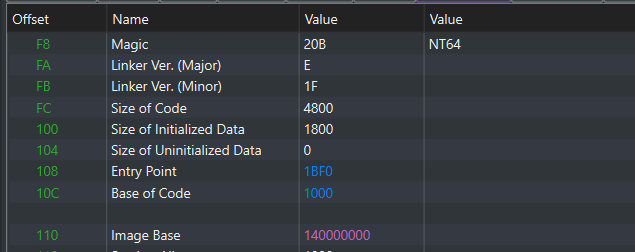  
Start with **PE-Bear**. This binary is 64bit.

  
Take a look at the sections. Notice there is a weird section called **ATOM**.  

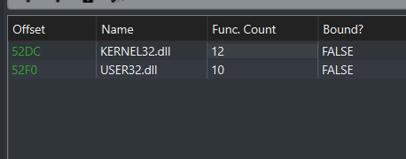  
And the imports only have 2 DLLs.   

Let's see if **DIE** provided something useful.  
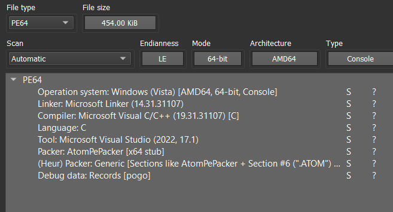  
The most important thing about the result is the binary was packed with a packer called **AtomPePacker**.

The entry point of program is full of junk code by calling a lot of Win32 APIs.

Let's start with **Static analysis**, Put the binary in **Ghidra**.  
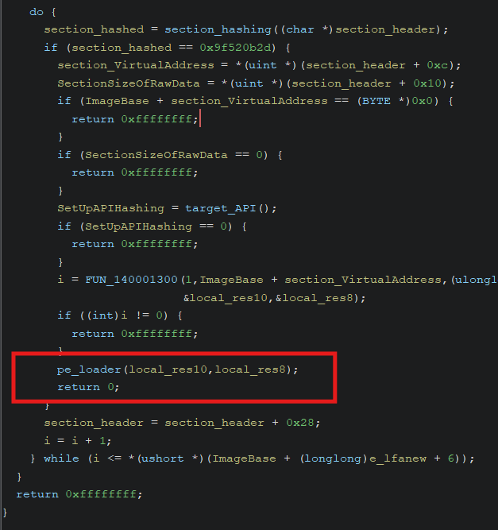  
In the entry point. Notice almost every **return** value is **0xffffffff** which is **-1** and there is only 1 that **returns 0**. 

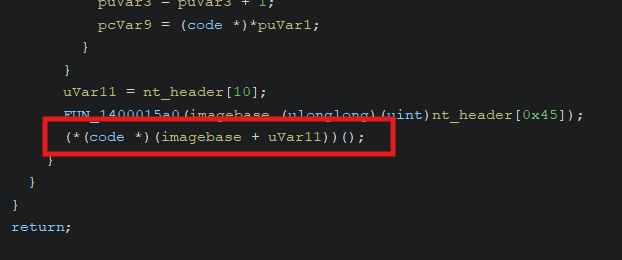  
In the end of function **pe_loader**, it calls a function pointer. This could be main function.  
The only way to prove this is using **Dynamic analysis**.  

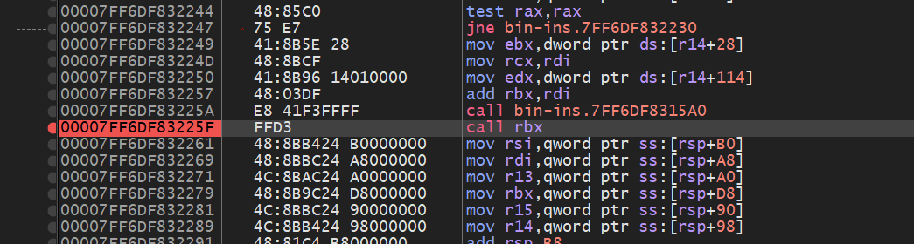  
Open **x64dbg** and Set break point at the function pointer that We just mention.  
Now let it run until it hits the break point.  

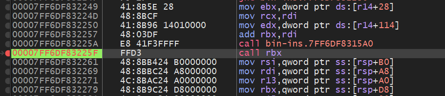  
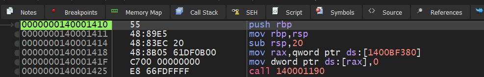  
And press step into, now we are inside the main function. But we can't analyze it yet, let's dump it and rebuild it with custom script.  

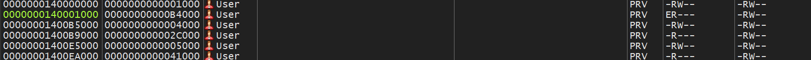  
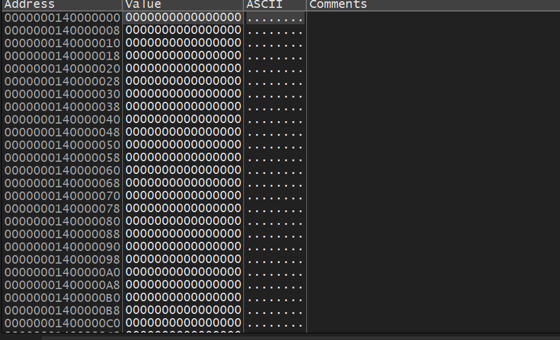    
But there is a problem, the header is missing. 0000000140000000 is supposed to be file header but it is empty. 
Let's take a step back.

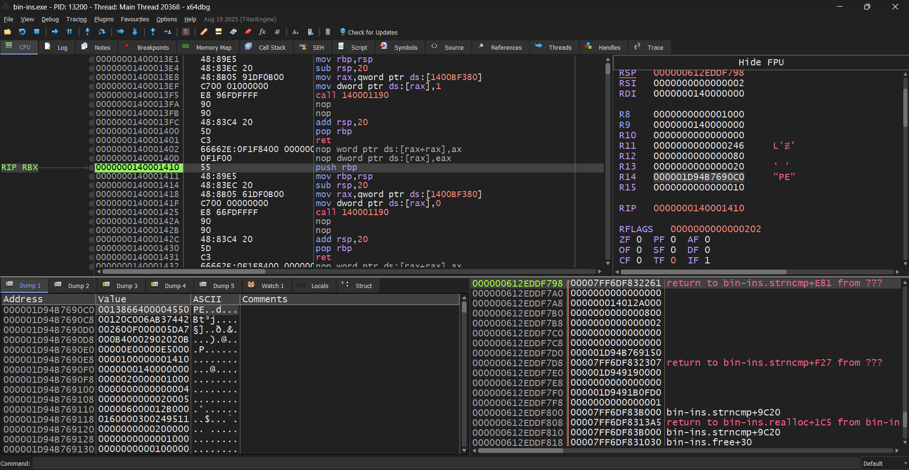  
Notice something in register R14 "PE". Let's follow in dump. 
>[NOTE]  
> If R14 does not point to the file header, we have to take steps back and use static analysis to see where it uses VirtualAlloc to allocate new memory and store the file header, which is going to be time-consuming and much more difficult.

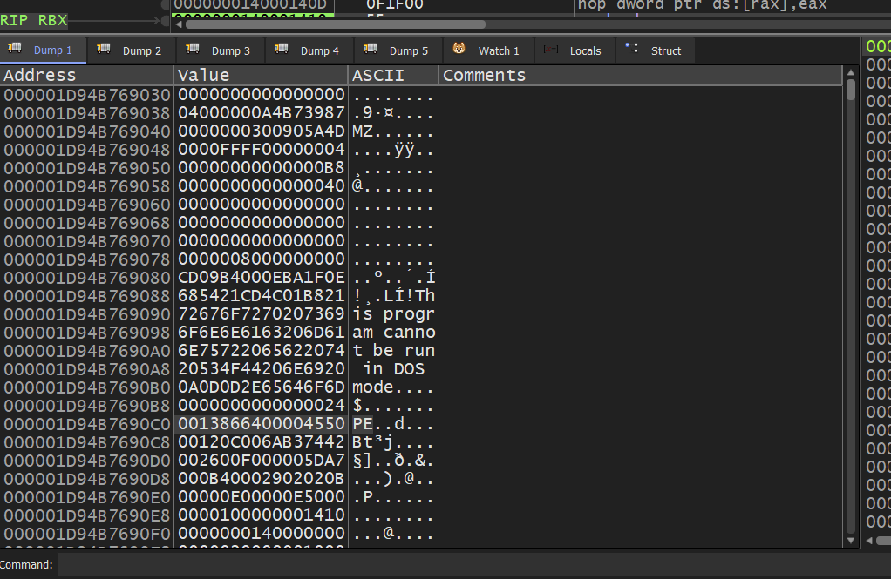  
This is the file header that we are looking for. let's dump it.  
How did I know? Look at all these clues.     
- **"MZ"** ("MZ" is the first 2 bytes of PE format)  
- **"This program cannot be run in dos mode"** (Legacy from DOS)  
- **"PE"**(PE signature) 
All of these are good enough to convince me this is the header that we need.  
And if you scroll down, you'll see the section names.  

<details>
<summary>Click to see Extract value script (ExtractValue.py)</summary>

```python
import re

#Dump from what we get after follow R14
dump_data = """
000001D94B769040 0000000300905A4D MZ...... 
000001D94B769048 0000FFFF00000004 ....ÿÿ.. 
000001D94B769050 00000000000000B8 ¸....... 
000001D94B769058 0000000000000040 @....... 
000001D94B769060 0000000000000000 ........ 
000001D94B769068 0000000000000000 ........ 
000001D94B769070 0000000000000000 ........ 
000001D94B769078 0000008000000000 ........ 
000001D94B769080 CD09B4000EBA1F0E ..º..´.Í 
000001D94B769088 685421CD4C01B821 !¸.LÍ!Th 
000001D94B769090 72676F7270207369 is progr 
000001D94B769098 6F6E6E6163206D61 am canno 
000001D94B7690A0 6E75722065622074 t be run 
000001D94B7690A8 20534F44206E6920  in DOS   
000001D94B7690B0 0A0D0D2E65646F6D mode.... 
000001D94B7690B8 0000000000000024 $....... 
000001D94B7690C0 0013866400004550 PE..d... 
000001D94B7690C8 00120C006AB37442 Bt³j.... 
000001D94B7690D0 002600F000005DA7 §]..ð.&. 
000001D94B7690D8 000B40002902020B ...).@.. 
000001D94B7690E0 00000E00000E5000 .P...... 
000001D94B7690E8 0000100000001410 ........ 
000001D94B7690F0 0000000140000000 ...@.... 
000001D94B7690F8 0000020000001000 ........ 
000001D94B769100 0000000000000004 ........ 
000001D94B769108 0000000000020005 ........ 
000001D94B769110 000006000012B000 .°...... 
000001D94B769118 0160000300249511 ..$...`. 
000001D94B769120 0000000000200000 .. ..... 
000001D94B769128 0000000000001000 ........ 
000001D94B769130 0000000000100000 ........ 
000001D94B769138 0000000000001000 ........ 
000001D94B769140 0000001000000000 ........ 
000001D94B769148 0000000000000000 ........ 
000001D94B769150 00001030000E6000 .`..0... 
000001D94B769158 0000000000000000 ........ 
000001D94B769160 0000AF68000CA000 . ..h¯.. 
000001D94B769168 0000000000000000 ........ 
000001D94B769170 00001658000EA000 . ..X... 
000001D94B769178 0000000000000000 ........ 
000001D94B769180 0000000000000000 ........ 
000001D94B769188 0000000000000000 ........ 
000001D94B769190 00000028000BDD20  Ý..(... 
000001D94B769198 0000000000000000 ........ 
000001D94B7691A0 0000000000000000 ........ 
000001D94B7691A8 000003C8000E6418 .d..È... 
000001D94B7691B0 0000000000000000 ........ 
000001D94B7691B8 0000000000000000 ........ 
000001D94B7691C0 0000000000000000 ........ 
000001D94B7691C8 000000747865742E .text... 
000001D94B7691D0 00001000000B3E80 .>...... 
000001D94B7691D8 00000600000B4000 .@...... 
000001D94B7691E0 0000000000000000 ........ 
000001D94B7691E8 6000006000000000 ....`..` 
000001D94B7691F0 000000617461642E .data... 
000001D94B7691F8 000B500000003040 @0...P.. 
000001D94B769200 000B460000003200 .2...F.. 
000001D94B769208 0000000000000000 ........ 
000001D94B769210 C000004000000000 ....@..À 
000001D94B769218 000061746164722E .rdata.. 
000001D94B769220 000B900000010AA0  ....... 
000001D94B769228 000B780000010C00 .....x.. 
000001D94B769230 0000000000000000 ........ 
000001D94B769238 4000004000000000 ....@..@ 
000001D94B769240 000061746164702E .pdata.. 
000001D94B769248 000CA0000000AF68 h¯... .. 
000001D94B769250 000C84000000B000 .°...... 
000001D94B769258 0000000000000000 ........ 
000001D94B769260 4000004000000000 ....@..@ 
000001D94B769268 000061746164782E .xdata.. 
000001D94B769270 000D50000000F2E4 äò...P.. 
000001D94B769278 000D34000000F400 .ô...4.. 
000001D94B769280 0000000000000000 ........ 
000001D94B769288 4000004000000000 ....@..@ 
000001D94B769290 000000007373622E .bss.... 
000001D94B769298 000E500000000DB0 °....P.. 
000001D94B7692A0 0000000000000000 ........ 
000001D94B7692A8 0000000000000000 ........ 
000001D94B7692B0 C000008000000000 .......À 
000001D94B7692B8 000061746164692E .idata.. 
000001D94B7692C0 000E600000001030 0....`.. 
000001D94B7692C8 000E280000001200 .....(.. 
000001D94B7692D0 0000000000000000 ........ 
000001D94B7692D8 C000004000000000 ....@..À 
000001D94B7692E0 000000005452432E .CRT.... 
000001D94B7692E8 000E800000000060 `....... 
000001D94B7692F0 000E3A0000000200 .....:.. 
000001D94B7692F8 0000000000000000 ........ 
000001D94B769300 C000004000000000 ....@..À 
000001D94B769308 00000000736C742E .tls.... 
000001D94B769310 000E900000000010 ........ 
000001D94B769318 000E3C0000000200 .....<.. 
000001D94B769320 0000000000000000 ........ 
000001D94B769328 C000004000000000 ....@..À 
000001D94B769330 0000636F6C65722E .reloc.. 
000001D94B769338 000EA00000001658 X.... .. 
000001D94B769340 000E3E0000001800 .....>.. 
000001D94B769348 0000000000000000 ........ 
000001D94B769350 4200004000000000 ....@..B 
000001D94B769358 000000000000342F /4...... 
000001D94B769360 000EC00000000980 .....À.. 
000001D94B769368 000E560000000A00 .....V.. 
000001D94B769370 0000000000000000 ........ 
000001D94B769378 4200004000000000 ....@..B 
000001D94B769380 000000000039312F /19..... 
000001D94B769388 000ED00000019A69 i....Ð.. 
000001D94B769390 000E600000019C00 .....`.. 
000001D94B769398 0000000000000000 ........ 
000001D94B7693A0 4200004000000000 ....@..B 
000001D94B7693A8 000000000031332F /31..... 
000001D94B7693B0 0010700000004990 .I...p.. 
000001D94B7693B8 000FFC0000004A00 .J...ü.. 
000001D94B7693C0 0000000000000000 ........ 
000001D94B7693C8 4200004000000000 ....@..B 
000001D94B7693D0 000000000035342F /45..... 
000001D94B7693D8 0010C0000000A37B {£...À.. 
000001D94B7693E0 001046000000A400 .¤...F.. 
000001D94B7693E8 0000000000000000 ........ 
000001D94B7693F0 4200004000000000 ....@..B 
000001D94B7693F8 000000000037352F /57..... 
000001D94B769400 0011700000001F18 .....p.. 
000001D94B769408 0010EA0000002000 . ...ê.. 
000001D94B769410 0000000000000000 ........ 
000001D94B769418 4200004000000000 ....@..B 
000001D94B769420 000000000030372F /70..... 
000001D94B769428 00119000000003D2 Ò....... 
000001D94B769430 00110A0000000400 ........ 
000001D94B769438 0000000000000000 ........ 
000001D94B769440 4200004000000000 ....@..B 
000001D94B769448 000000000031382F /81..... 
000001D94B769450 0011A00000002DB0 °-... .. 
000001D94B769458 00110E0000002E00 ........ 
000001D94B769460 0000000000000000 ........ 
000001D94B769468 4200004000000000 ....@..B 
000001D94B769470 000000000037392F /97..... 
000001D94B769478 0011D0000000C782 .Ç...Ð.. 
000001D94B769480 00113C000000C800 .È...<.. 
000001D94B769488 0000000000000000 ........ 
000001D94B769490 4200004000000000 ....@..B 
000001D94B769498 000000003331312F /113.... 
000001D94B7694A0 0012A00000000629 ).... .. 
000001D94B7694A8 0012040000000800 ........ 
000001D94B7694B0 0000000000000000 ........ 
000001D94B7694B8 4200004000000000 ....@..B 
000001D94B7694C0 0000000000000000 ........ 
"""

exe_buffer = bytearray()

for line in dump_data.strip().splitlines():
    match = re.match(r"^[0-9A-Fa-f]{16}\s+([0-9A-Fa-f]{16})", line.strip())
    if match:
        qword_bytes = bytes.fromhex(match.group(1))[::-1]
        exe_buffer.extend(qword_bytes)

with open("header2.bin", "wb") as f_out:
    f_out.write(exe_buffer)

print(f"\n[+] Extract header complete ({len(exe_buffer)} bytes)")
```

</details>  

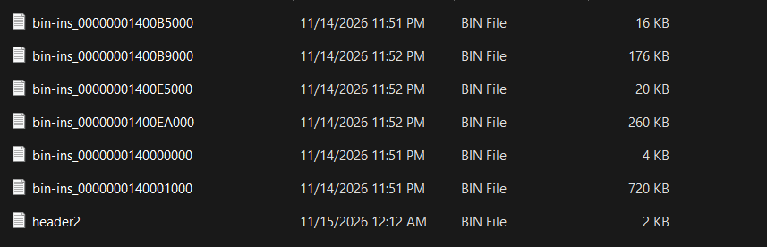  
This is the result after we dump everything.  
Let's rebuild it with custom script.

<details>
<summary>Click to see Custom rebuild PE script (Reconstruct.py)</summary>

```python
import struct
import os
import glob

# 1. Load Header
with open("header2.bin", "rb") as f:
    header_data = f.read()

e_lfanew = struct.unpack_from("<I", header_data, 0x3c)[0]
num_sections = struct.unpack_from("<H", header_data, e_lfanew + 6)[0]
size_of_optional_header = struct.unpack_from("<H", header_data, e_lfanew + 20)[0]
optional_header_offset = e_lfanew + 24
section_header_offset = optional_header_offset + size_of_optional_header

magic = struct.unpack_from("<H", header_data, optional_header_offset)[0]
image_base = struct.unpack_from("<Q" if magic == 0x20B else "<I", header_data, optional_header_offset + (24 if magic == 0x20B else 28))[0]

# 2. Scan and load bin-ins_*.bin into Memory Address Range (Start_VA -> End_VA)
dump_ranges = []
for filepath in glob.glob("bin-ins_*.bin"):
    filename = os.path.basename(filepath)
    try:
        # Extract Hex after 'bin-ins_'
        va_hex = filename.split("_")[1].split(".")[0]
        start_va = int(va_hex, 16)
        
        with open(filepath, "rb") as f:
            data = f.read()
            
        end_va = start_va + len(data)
        dump_ranges.append({
            'filename': filename,
            'start_va': start_va,
            'end_va': end_va,
            'data': data
        })
        print(f"[*] Loaded Dump: {filename} (Range: {hex(start_va)} - {hex(end_va)})")
    except Exception as e:
        print(f"[-] Could not parse {filename}: {e}")

# 3. Calculate exe_buffer size
max_raw_end = len(header_data)
for i in range(num_sections):
    ptr = struct.unpack_from("<I", header_data, section_header_offset + i * 40 + 20)[0]
    size = struct.unpack_from("<I", header_data, section_header_offset + i * 40 + 16)[0]
    if ptr > 0:
        max_raw_end = max(max_raw_end, ptr + size)

exe_buffer = bytearray(max_raw_end)
exe_buffer[0:len(header_data)] = header_data

# 4. Map data with Dynamic Range Matching
for i in range(num_sections):
    offset = section_header_offset + i * 40
    section_name = header_data[offset:offset+8].strip(b'\x00').decode("ascii", errors='ignore')
    virtual_addr = struct.unpack_from("<I", header_data, offset+12)[0]
    raw_size = struct.unpack_from("<I", header_data, offset+16)[0]
    raw_ptr = struct.unpack_from("<I", header_data, offset+20)[0]

    if raw_ptr == 0 or raw_size == 0:
        continue

    full_va = image_base + virtual_addr
    mapped = False

    # Find which dump file memory range includes this section's full_va
    for dump in dump_ranges:
        if dump['start_va'] <= full_va < dump['end_va']:
            offset_in_bin = full_va - dump['start_va']
            slice_data = dump['data'][offset_in_bin : offset_in_bin + raw_size]
            
            if raw_ptr + len(slice_data) > len(exe_buffer):
                exe_buffer.extend(b'\x00' * (raw_ptr + len(slice_data) - len(exe_buffer)))
                        
            exe_buffer[raw_ptr : raw_ptr + len(slice_data)] = slice_data
            print(f"[+] Mapped [{section_name}] (VA: {hex(full_va)}) <- {dump['filename']} (+{hex(offset_in_bin)}) to RawPtr {hex(raw_ptr)}")
            mapped = True
            break
    if mapped == False:
        print(f"[-] [{section_name}] is not mapped")

# 5. Save file
with open("rebuilt.exe", "wb") as f_out:
    f_out.write(exe_buffer)
print("\n[+] Rebuilt file saved dynamically as rebuilt.exe")

```

</details>  

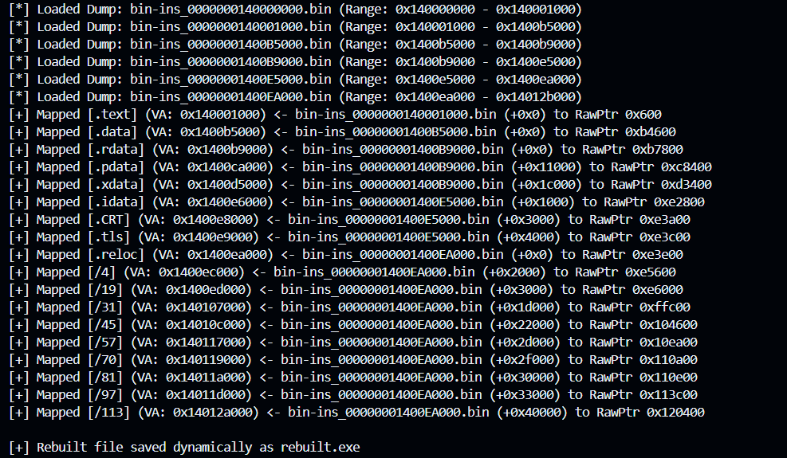  
This is the result of the script and we expect **rebuilt.exe** file.  

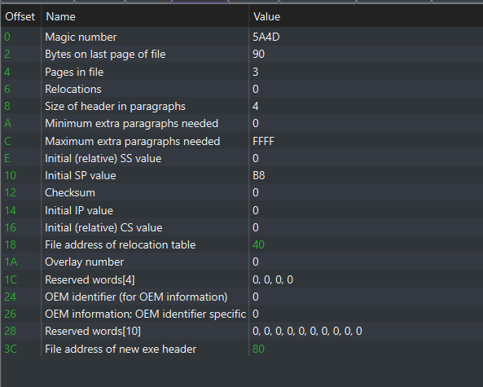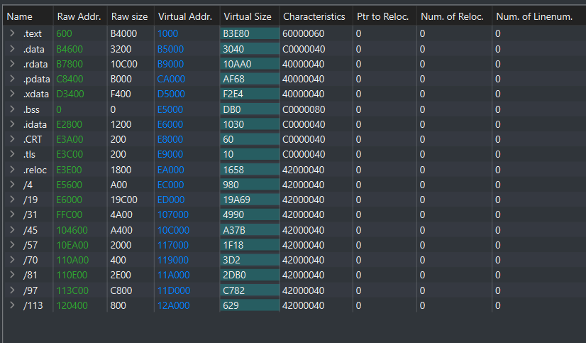  
Let's see if rebuilt.exe is a valid PE format to make sure the file isn't corrupted.  
Everything look legitimate, So let's analyze this binary.  

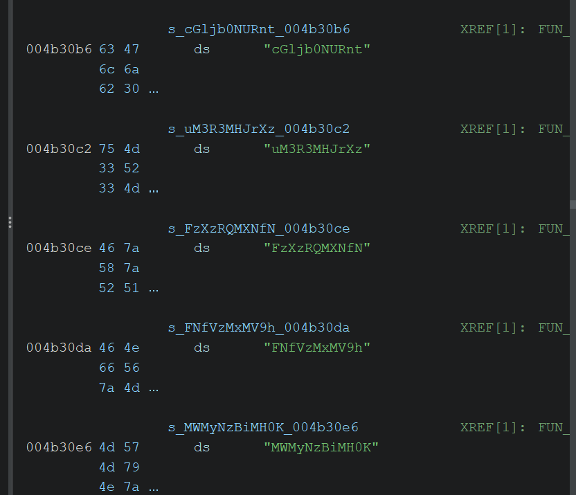  
Opening the .rdata section reveals a Base64-encoded string.  
Let's decode it.  

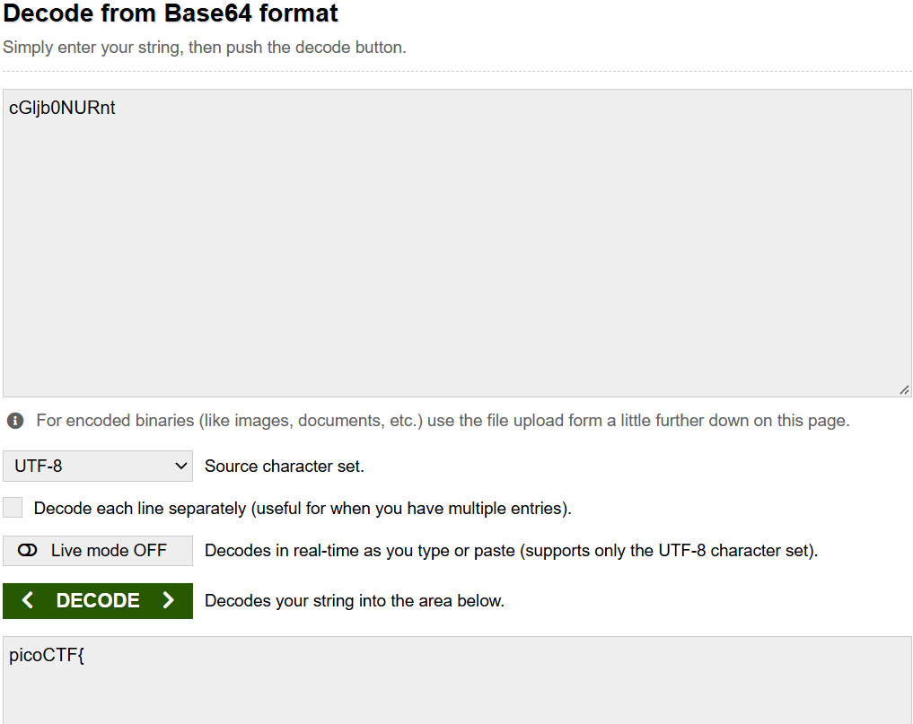  
!!!**cGljb0NURnt** is **picoCTF{**.  

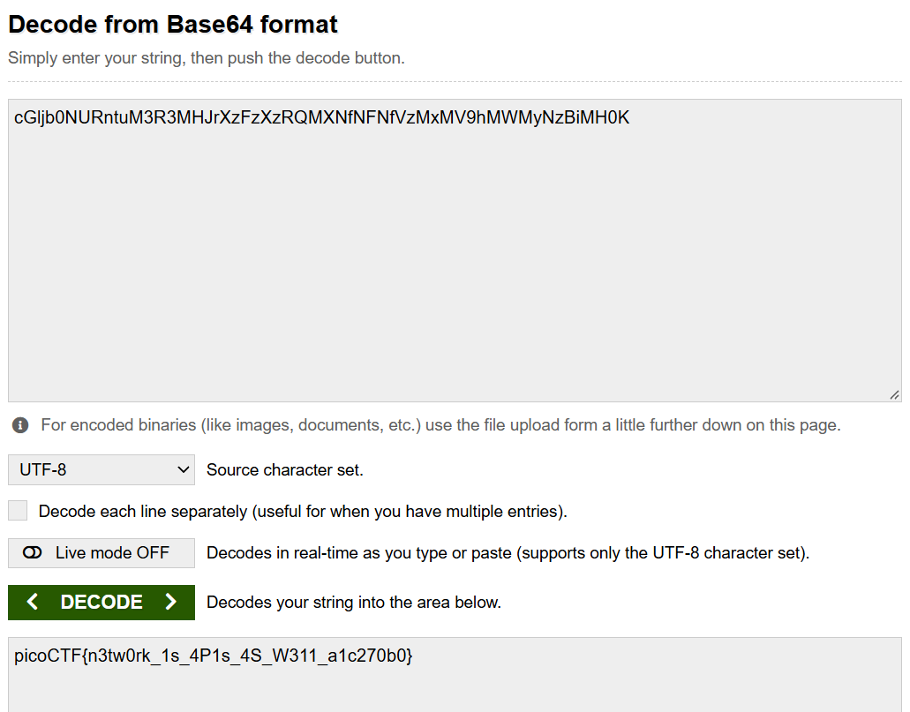  
After decrypted everything, the flag is **picoCTF{n3tw0rk_1s_4P1s_4S_W311_a1c270b0}**.

## Bonus
I found something very interesting. The binary (bin-ins.exe) uses **Direct Syscalls**.  

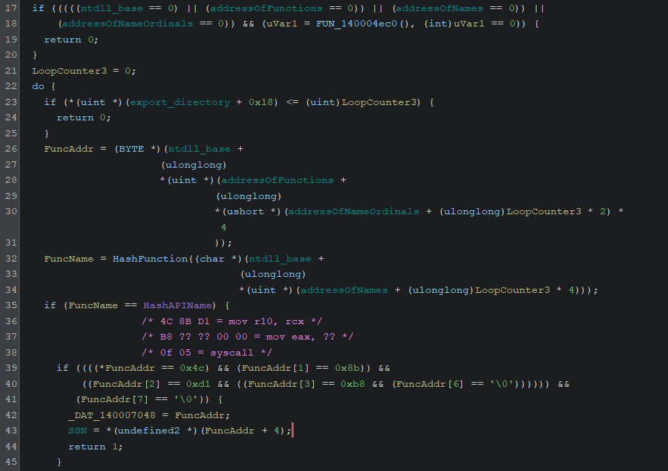  
This is **Export Address Table walking**. It finds the function name using a hashed parameter, and then extracts the SSN (System Service Number). But it's also check if the function got hooked, if the **first byte** or the **fourth byte** was hooked (**0xE9** which **jmp** instruction), it's react differently (see in the next section).

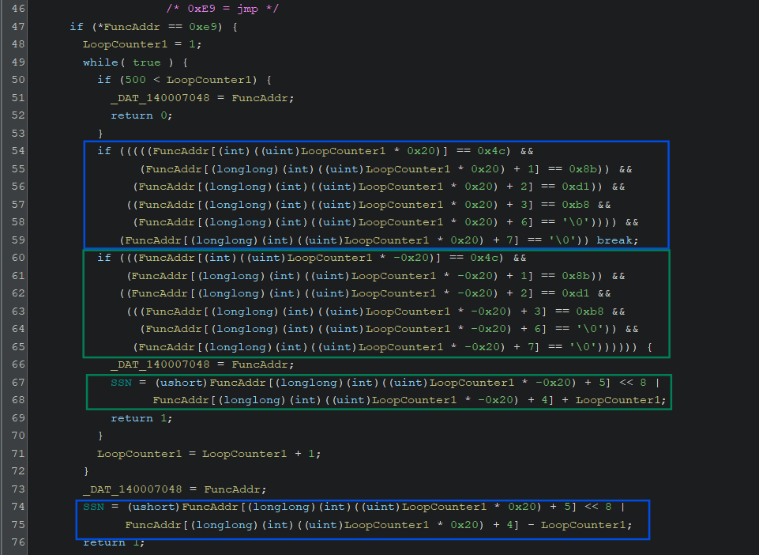  
**Case: The first byte was hooked**  
The **upper blue box** (lines 54–59) scans downward through subsequent syscall stubs (each stub is **0x20** bytes in size) using positive offsets (**LoopCounter1 * 0x20**) until it finds an unhooked stub, then breaks out of the loop.  
The **lower blue box** (lines 74–75) calculates the target SSN from that clean neighboring stub.  
- **FuncAddr[(LoopCounter1 * 0x20)]** points to the unhooked neighboring function.
- Adding **+ 5** reads the **high byte** of its SSN (**FuncAddr[(LoopCounter1 * 0x20) + 5]**), which is then shifted left by **8 bits** ( **<< 8** ).
- Adding **+ 4** reads the **low byte** (**FuncAddr[(LoopCounter1 * 0x20) + 4]**)
- Combining them with a bitwise OR (**|**) reconstructs the 16-bit SSN of the neighboring stub.  
- Finally, subtracting **LoopCounter1** (**- LoopCounter1**) compensates for the distance, yielding the true SSN of our hooked target function.  

Samething happened with the **green boxs** but instead of going down like blue box, its going up.


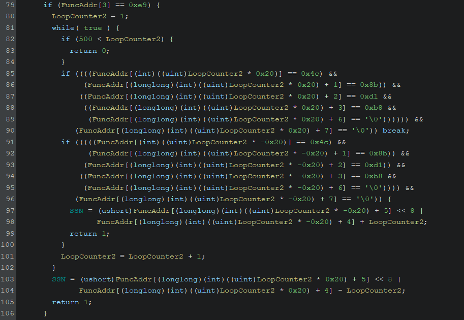  
**Case: The fourth byte was hooked**  
The exact samething happened like the previous section.